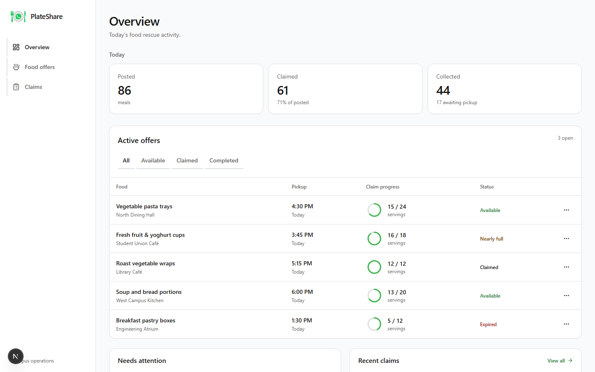
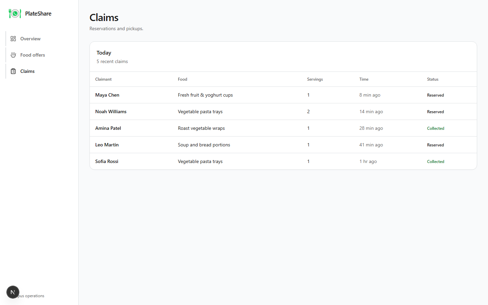

<div align="center">

# PlateShare

**Every campus canteen throws away good food at closing time. Every student is hungry at 5 pm.**
PlateShare puts one WhatsApp message between the two.

🏆 *Winner, Global Challenge hackathon.*

</div>



## The idea

Nobody downloads another app for a free sandwich. So PlateShare isn't one.

A canteen manager sends a single message. Every registered student gets pinged. The first to reply claims the meal. Nothing goes in the bin, and nobody installs anything.

```
Canteen   POST 17:30 Rice and beans, 20 portions
PlateShare  Posted. Students notified. Closes at 17:30.

Student   CLAIM 42
PlateShare  Claimed! Head to the canteen now.
```

Three commands. That is the whole interface:

| Command | Who | What it does |
|---|---|---|
| `REGISTER <name>` | Student | Joins the list for food alerts |
| `POST <HH:MM> <description>` | Canteen | Publishes surplus food with a claim deadline |
| `CLAIM <id>` | Student | Reserves a portion. Late or taken, you're told straight |

## What's in the box

| Part | Folder | Built with |
|---|---|---|
| WhatsApp bot | [`api/`](api) | Node.js, Express, Twilio, Supabase |
| Canteen dashboard | [`Dashboard/`](Dashboard) | Next.js, TypeScript, Tailwind, Radix UI |

The bot handles registration, broadcasts and first-come claiming, and refuses claims past the deadline. The dashboard gives staff a live view of what was posted, claimed and collected.



> The dashboard runs on sample data today (`Dashboard/lib/mock-data.ts`). The bot is the part wired to a real database.

## Run it

**Bot**

```bash
cd api
npm install
cp .env.example .env   # TWILIO_SID, TWILIO_TOKEN, SUPABASE_URL, SUPABASE_KEY, PORT
# Create the tables first: run api/schema.sql in the Supabase SQL editor
npm start
```

Point your Twilio WhatsApp sandbox webhook at `POST /webhook`.

**Dashboard**

```bash
cd Dashboard
npm install
npm run dev
```

## Author

Built by [Rydny](https://github.com/Rydny1).
